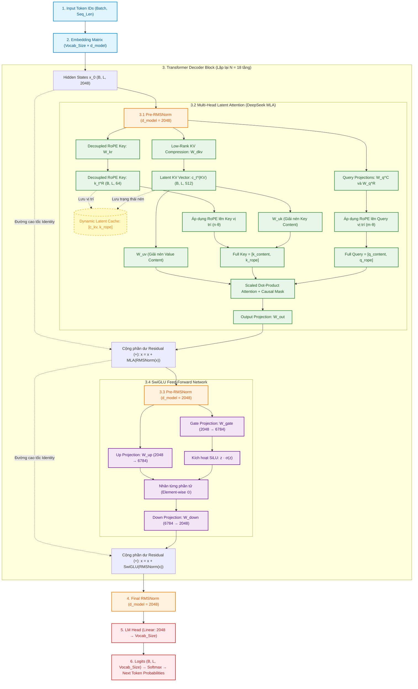

# KIẾN TRÚC MÔ HÌNH 1B BASE MODEL: GIẢI PHẪU TOÀN DIỆN
## (Modern Decoder-Only Transformer with DeepSeek Multi-Head Latent Attention)

Tài liệu này cung cấp sơ đồ kỹ thuật chi tiết bằng **Mermaid.js v11** và bài giải phẫu toán học chuyên sâu cho mô hình **1 Tỷ tham số (1.006B Parameters)** được huấn luyện từ số 0 trong dự án Capstone.

---

## 1. Sơ Đồ Kiến Trúc Luồng Dữ Liệu (Mermaid.js v11 Architecture)

---

## 2. Thông Số Kiến Trúc (Architecture Hyperparameters)

| Tham số cấu hình | Giá trị | Ý nghĩa kỹ thuật |
| :--- | :---: | :--- |
| **`vocab_size`** | $2,048$ (hoặc $16,384$) | Kích thước từ điển Byte-level BPE (0% OOV). |
| **`hidden_dim` ($d_{\text{model}}$)** | $2048$ | Kích thước không gian biểu diễn ẩn của mỗi token. |
| **`num_layers` ($N$)** | $18$ | Số lượng khối Transformer Decoder xếp chồng. |
| **`num_heads` ($n_{\text{heads}}$)** | $16$ | Số đầu Attention song song. |
| **`head_dim` ($d_h$)** | $128$ | Kích thước của mỗi đầu Attention nội dung. |
| **`kv_lora_rank` ($d_c$)** | $512$ | Kích thước vector tiềm ẩn nén Key-Value (Latent KV). |
| **`qk_rope_head_dim` ($d_r$)** | $64$ | Kích thước vector vị trí tách biệt áp dụng RoPE. |
| **`intermediate_dim` ($d_{\text{ffn}}$)** | $6784$ | Kích thước lớp ẩn mở rộng của SwiGLU FFN. |
| **`max_seq_len`** | $2048$ | Chiều dài ngữ cảnh tối đa (Context Length). |
| **Tổng số tham số** | **$1,006,455,808$** | **Chuẩn 1 Tỷ tham số ($1.006\text{B}$)**. |

---

## 3. Giải Thích Chi Tiết Từng Thành Phần (Layer-by-Layer Deep Dive)

### 3.1. Token Embedding Matrix (`embed_tokens`)
- **Bản chất:** Bảng tra cứu trọng số $\mathbb{R}^{V \times d_{\text{model}}}$.
- **Hoạt động:** Chuyển đổi mỗi Token ID dạng số nguyên thành một vector thực dày đặc (dense vector) $2048$ chiều.
- **Điểm đột phá hiện đại:** Không sử dụng Positional Embedding cộng vào vector đầu vào như Transformer cũ. Thông tin tọa độ vị trí được đẩy vào tầng Attention thông qua phép quay RoPE.

---

### 3.2. Pre-RMSNorm (Root Mean Square Normalization)
- **Công thức toán học:**
  $$\text{RMS}(x) = \sqrt{\frac{1}{d} \sum_{i=1}^d x_i^2 + \epsilon}$$
  $$\text{RMSNorm}(x) = \frac{x}{\text{RMS}(x)} \odot \gamma$$
  *(với $\gamma \in \mathbb{R}^{d}$ là trọng số học được).*
- **Vai trò:**
  1. Ổn định biên độ dao động của vector sau các phép cộng phần dư (`Residual`), ngăn chặn hiện tượng nổ kích hoạt (`Exploding Activations`).
  2. Bỏ qua bước tính trung bình $\mu$, giúp GPU tiết kiệm **~15% chi phí tính toán kernel** so với LayerNorm truyền thống.
  3. Pre-Norm tạo ra "đường cao tốc" Identity giúp gradient truyền thẳng tắp từ tầng cuối về tầng đầu mà không bị bóp nghẹt.

---

### 3.3. Multi-Head Latent Attention (DeepSeek MLA)
Kiến trúc Attention tiên tiến nhất hiện nay (vũ khí cốt lõi của DeepSeek-V2, V3 và DeepSeek-R1):

#### a. Nén Low-Rank Key-Value (Low-Rank KV Compression)
Thay vì chiếu trạng thái $x$ thành các đầu Key và Value độc lập có kích thước khổng lồ ($16 \times 128 \times 2 = 4096$ chiều), MLA nén toàn bộ không gian này về một vector tiềm ẩn duy nhất:
$$\mathbf{c}_t^{KV} = \text{RMSNorm}(x W^{DKV}) \in \mathbb{R}^{512}$$
- **Hiệu quả:** **Bộ nhớ KV Cache chỉ cần lưu vector 512 chiều này**. VRAM tiêu thụ cho cache giảm tới **86%** so với MHA truyền thống.

#### b. Decoupled Rotary Position Embedding (Decoupled RoPE)
Do phép quay RoPE không thể giao hoán với ma trận giải nén, MLA tách riêng một vector RoPE:
$$\mathbf{k}_t^R = x W^{KR} \in \mathbb{R}^{64}$$
Phép quay 2D RoPE được áp dụng trực tiếp lên $\mathbf{k}_t^R$ và phần Query RoPE $\mathbf{q}_t^R$ tương ứng:
$$\mathbf{k}_{t, \text{rot}}^R = R_t \mathbf{k}_t^R, \quad \mathbf{q}_{t, \text{rot}}^R = R_t \mathbf{q}_t^R$$

#### c. Tính Toán Attention
- Giải nén $\mathbf{c}_t^{KV}$ thành Key và Value nội dung:
  $$\mathbf{k}^C = \mathbf{c}^{KV} W^{UK}, \quad \mathbf{v}^C = \mathbf{c}^{KV} W^{UV}$$
- Ghép toàn diện:
  $$\mathbf{Q} = [\mathbf{q}^C, \mathbf{q}_{\text{rot}}^R] \in \mathbb{R}^{B \times 16 \times L \times (128 + 64)}$$
  $$\mathbf{K} = [\mathbf{k}^C, \mathbf{k}_{\text{rot}}^R] \in \mathbb{R}^{B \times 16 \times S \times (128 + 64)}$$
- Tính toán ma trận Attention kèm Causal Mask và nhân với Value $\mathbf{v}^C$:
  $$\text{Attention}(\mathbf{Q}, \mathbf{K}, \mathbf{V}) = \text{Softmax}\left(\frac{\mathbf{Q} \mathbf{K}^T}{\sqrt{128 + 64}} + M_{\text{causal}}\right) \mathbf{v}^C$$

---

### 3.4. SwiGLU Feed-Forward Network (FFN)
Khối FFN chiếm khoảng 2/3 tổng số tham số của mô hình, đóng vai trò như "bộ nhớ tri thức sự kiện" (Factual Memory):

- **Công thức:**
  $$\text{SwiGLU}(x) = \Big( \text{SiLU}(x W_{\text{gate}}) \odot (x W_{\text{up}}) \Big) W_{\text{down}}$$
- **Giải thích:**
  1. **Nhánh $W_{\text{up}}$:** Chiếu vector từ $2048$ lên không gian trung gian mở rộng $6784$ chiều.
  2. **Nhánh $W_{\text{gate}}$:** Đi qua hàm kích hoạt $\text{SiLU}(z) = z \cdot \text{sigmoid}(z)$, đóng vai trò "cánh cổng" (Gate) kiểm soát lượng tri thức được phép kích hoạt.
  3. **Phép nhân từng phần tử $\odot$:** Tạo ra tương tác phi tuyến tính bậc hai cực kỳ mạnh mẽ.
  4. **Nhánh $W_{\text{down}}$:** Nén ngược từ $6784$ về $2048$ để cộng vào đường cao tốc Residual.

---

### 3.5. Final RMSNorm & LM Head
- **Final RMSNorm:** Chuẩn hóa toàn bộ vector $2048$ chiều của token sau khi đi qua trọn vẹn 18 tầng transformer.
- **LM Head:** Chiếu tuyến tính từ không gian ẩn $d_{\text{model}} = 2048$ sang kích thước từ điển $V$.
- **Đầu ra Logits:** Điểm số chưa chuẩn hóa đại diện cho xác suất xuất hiện của từng từ vựng trong từ điển tại vị trí tiếp theo.
