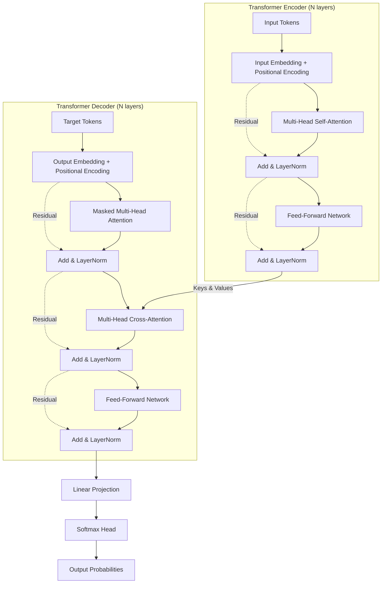

# Kiến Trúc Transformer: Từ Nền Tảng Đến Thực Thi (Deep Dive)

Tài liệu này cung cấp cái nhìn toàn diện, trực quan và chuyên sâu về kiến trúc **Transformer** — nền tảng cốt lõi của các Mô hình Ngôn ngữ Lớn (LLM) và các hệ thống AI hiện đại nhất hiện nay.

---

## Mục Lục
1. [Bối Cảnh Lịch Sử & Vì Sao Cần Transformer?](#1-bối-cảnh-lịch-sử--vì-sao-cần-transformer)
   - [Từ One-hot đến Word Embedding](#từ-one-hot-đến-word-embedding)
   - [RNN & LSTM: Cơ chế tuần tự và hai "tử huyệt"](#rnn--lstm-cơ-chế-tuần-tự-và-hai-tử-huyệt)
   - [Seq2Seq và điểm nghẽn "Information Bottleneck"](#seq2seq-và-điểm-nghẽn-information-bottleneck)
   - [Cơ chế Attention: Bước đệm lịch sử](#cơ-chế-attention-bước-đệm-lịch-sử)
2. [Cấu Trúc Chi Tiết Của Transformer](#2-cấu-trúc-chi-tiết-của-transformer)
   - [Sơ đồ tổng quan kiến trúc](#sơ-đồ-tổng-quan-kiến-trúc)
   - [Embedding & Positional Encoding](#embedding--positional-encoding)
   - [Cơ chế Scaled Dot-Product Attention ($Q, K, V$)](#cơ-chế-scaled-dot-product-attention-q-k-v)
   - [Multi-Head Attention (Chú ý đa đầu)](#multi-head-attention-chú-ý-đa-đầu)
   - [Residual Connection & Layer Normalization](#residual-connection--layer-normalization)
   - [Feed-Forward Network (FFN)](#feed-forward-network-ffn)
   - [Nhánh Decoder: Masked Attention & Cross-Attention](#nhánh-decoder-masked-attention--cross-attention)
3. [Phân Loại & Các Biến Thể Của Transformer](#3-phân-loại--các-biến-thể-của-transformer)
   - [Encoder-only (BERT)](#encoder-only-bert)
   - [Decoder-only (GPT, LLaMA, Gemini)](#decoder-only-gpt-llama-gemini)
   - [Encoder-Decoder (T5, BART)](#encoder-decoder-t5-bart)
   - [Vision Transformer (ViT)](#vision-transformer-vit)
4. [Ánh Xạ Kiến Trúc Vào Mã Nguồn Dự Án (`transformer.py`)](#4-ánh-xạ-kiến-trúc-vào-mã-nguồn-dự-án-transformerpy)
5. [Tài Liệu Tham Khảo](#5-tài-liệu-tham-khảo)

---

## 1. Bối Cảnh Lịch Sử & Vì Sao Cần Transformer?

Để hiểu vì sao Transformer trở thành cuộc cách mạng, ta cần nhìn lại cách mà Xử lý Ngôn ngữ Tự nhiên (NLP) đã giải quyết bài toán chuỗi văn bản trước năm 2017.

### Từ One-hot đến Word Embedding
- **One-hot Encoding:** Coi mỗi từ trong từ điển $V$ là một vector thưa thớt (sparse vector) có kích thước $|V|$ với chỉ duy nhất một số 1.
  - *Nhược điểm:* Chiều dữ liệu cực lớn, tốn RAM và hoàn toàn không nắm bắt được khoảng cách ngữ nghĩa giữa các từ (từ "chó" và "mèo" có tích vô hướng bằng 0, xem như không hề liên quan).
- **Word Embedding (Word2Vec, GloVe):** Chiếu mỗi từ vào một không gian vector thực liên tục và dày đặc (dense vector) $d$-chiều (ví dụ 300, 512):
  $$\text{Vector}(\text{"Vua"}) - \text{Vector}(\text{"Đàn ông"}) + \text{Vector}(\text{"Phụ nữ"}) \approx \text{Vector}(\text{"Nữ hoàng"})$$

### RNN & LSTM: Cơ chế tuần tự và hai "tử huyệt"
Mạng nơ-ron hồi quy (**RNN**) và **LSTM/GRU** được thiết kế để xử lý dữ liệu dạng chuỗi bằng cách nạp từng từ một theo thứ tự thời gian:

$$h_t = \tanh(W x_t + U h_{t-1} + b)$$

Mặc dù giải quyết được bài toán chuỗi có độ dài thay đổi, kiến trúc này mắc phải **2 hạn chế chí mạng**:
1. **Bế tắc tính toán song song (Sequential Bottleneck):** Muốn tính toán trạng thái ẩn $h_{100}$, ta bắt buộc phải đợi tính xong $h_1, h_2, \dots, h_{99}$. Không thể tận dụng tính toán song song của GPU.
2. **Quên thông tin tầm xa (Vanishing / Exploding Gradient):** Thông tin từ các từ đầu câu bị pha loãng dần qua từng bước thời gian. Ví dụ:
   > *"Tôi sinh ra ở **Việt Nam**,... (100 từ mô tả kỷ niệm)..., vì vậy tôi nói thành thạo tiếng **Việt**."*
   RNN khó lòng giữ được mối liên kết giữa từ "Việt Nam" ở đầu và từ "Việt" ở cuối câu.

### Seq2Seq và điểm nghẽn "Information Bottleneck"
Trong bài toán dịch máy kinh điển (Seq2Seq):
- **Encoder** đọc toàn bộ câu nguồn và nén toàn bộ nội dung vào **1 vector ngữ cảnh cố định duy nhất** ($C$).
- **Decoder** nhận $C$ để sinh ra câu đích.

*Ẩn dụ đời thực:* Giống như một thông dịch viên phải nghe bài phát biểu dài 10 phút, không được ghi chép, chỉ được nhớ một ý niệm chung trong đầu rồi nói lại toàn bộ bài văn. Câu càng dài, thông tin bị mất mát càng nghiêm trọng.

### Cơ chế Attention: Bước đệm lịch sử
Năm 2014, Bahdanau cùng cộng sự đề xuất: **Tại sao Decoder phải phụ thuộc vào một vector tóm tắt duy nhất?**
- Khi Decoder chuẩn bị sinh từ tiếp theo, nó được phép "nhìn lại" toàn bộ các trạng thái ẩn của Encoder và **tập trung sự chú ý (attention weight)** vào các từ liên quan nhất trong câu gốc.
- Đến năm 2017, các kỹ sư tại Google Research công bố bài báo kinh điển: **"Attention Is All You Need"** với thông điệp: *Nếu Attention mạnh như vậy, hãy loại bỏ hoàn toàn RNN/CNN, chỉ dùng cơ chế Attention để xây dựng mạng nơ-ron.* Đó chính là **Transformer**.

---

## 2. Cấu Trúc Chi Tiết Của Transformer

### Sơ đồ tổng quan kiến trúc



---

### Embedding & Positional Encoding

Vì Transformer không đọc tuần tự mà nạp toàn bộ các từ trong câu cùng lúc, mô hình **không hề biết từ nào đứng trước, từ nào đứng sau**. 

Nếu không có vị trí, hai câu sau sẽ hoàn toàn giống hệt nhau đối với Transformer:
> 1. *"Mèo đuổi chuột"*
> 2. *"Chuột đuổi mèo"*

**Giải pháp:** Bổ sung vector mã hóa vị trí (Positional Encoding - $PE$) vào vector từ (Word Embedding - $WE$):
$$\text{Input}(x) = WE(x) + PE(pos)$$

Có 2 cách tạo $PE$:
1. **Sinusoidal Positional Encoding (Công thức toán):**
   $$PE_{(pos, 2i)} = \sin\left(\frac{pos}{10000^{2i/d_{\text{model}}}}\right)$$
   $$PE_{(pos, 2i+1)} = \cos\left(\frac{pos}{10000^{2i/d_{\text{model}}}}\right)$$
2. **Learned Positional Embedding:** Khởi tạo bảng trọng số ngẫu nhiên `nn.Embedding(max_length, embed_dim)` và để mô hình tự học giá trị tối ưu qua Backpropagation (cách tiếp cận được dùng trong file code bài giảng).

---

### Cơ chế Scaled Dot-Product Attention ($Q, K, V$)

Mọi phép tính trong Transformer đều xoay quanh 3 thành phần:
- **Query ($Q$):** Từ đang đi tìm kiếm thông tin ngữ cảnh.
- **Key ($K$):** Nhãn/đặc trưng của các từ có thể chứa thông tin liên quan.
- **Value ($V$):** Nội dung thông tin ngữ nghĩa thực tế của từ.

#### Ẩn dụ thực tế: "Hệ Thống Tìm Kiếm Thông Tin"
- **Query ($Q$):** Bạn gõ vào Google từ khóa: *"cách làm phở bò"*.
- **Key ($K$):** Tiêu đề của hàng triệu bài viết trên mạng: *"hướng dẫn nấu phở bò"*, *"cách làm bún bò"*, *"tin tức thời sự"*.
- **So khớp ($Q \times K^T$):** Hệ thống tính mức độ tương đồng giữa Query của bạn và Key của các bài viết. Bài viết về *"phở bò"* được 0.85 điểm, *"bún bò"* được 0.14 điểm, *"thời sự"* được 0.01 điểm.
- **Value ($V$):** Nội dung chi tiết bên trong bài viết.
- **Kết quả:** Tổng hợp nội dung các bài viết theo tỷ lệ điểm số tương ứng:
  $$\text{Kết quả} = 0.85 \times V_{\text{phở bò}} + 0.14 \times V_{\text{bún bò}} + 0.01 \times V_{\text{thời sự}}$$

#### Công thức toán học:
$$\text{Attention}(Q, K, V) = \text{softmax}\left(\frac{Q K^T}{\sqrt{d_k}}\right) V$$

#### Phân tích chi tiết từng toán tử:
1. **$Q K^T$ (Dot-product):** Tích vô hướng giữa hai vector thể hiện góc cosine giữa chúng. Hai vector càng hướng về cùng một chiều (ngữ nghĩa càng gần), tích vô hướng càng lớn.
2. **Chia cho $\sqrt{d_k}$ (Scaling Factor):**
   - Khi chiều không gian $d_k$ lớn (ví dụ $d_k=64$), tích vô hướng $Q K^T$ có thể nhận giá trị rất lớn.
   - Khi đó, hàm `softmax` sẽ cho ra các xác suất tiệm cận 1 và 0 $\rightarrow$ đạo hàm tiệm cận về 0 (vùng bão hòa), dẫn đến **triệt tiêu gradient (vanishing gradients)**.
   - Chia cho $\sqrt{d_k}$ giúp phương sai của tích vô hướng luôn duy trì bằng 1, ổn định việc tính đạo hàm.
3. **`softmax(...)`:** Chuẩn hóa các điểm số so khớp thành một phân phối xác suất (tổng bằng 1.0).
4. **Nhân với $V$:** Lấy tổ hợp tuyến tính các vector giá trị theo trọng số xác suất chú ý.

---

### Multi-Head Attention (Chú ý đa đầu)

Thay vì chỉ tính một cơ chế chú ý đơn lẻ trên vector kích thước $d_{\text{model}}$, Transformer chia nhỏ vector thành $h$ phần (heads) song song:

$$\text{MultiHead}(Q, K, V) = \text{Concat}(\text{head}_1, \dots, \text{head}_h) W^O$$
$$\text{head}_i = \text{Attention}(Q W_i^Q, K W_i^K, V W_i^V)$$

**Tại sao cần nhiều Heads?**
Mỗi head đóng vai trò như một "lăng kính" độc lập:
- **Head 1:** Tập trung vào quan hệ cú pháp (động từ đi liền với danh từ nào).
- **Head 2:** Tập trung vào đại từ thay thế (từ "nó", "họ" đang chỉ thực thể nào trước đó).
- **Head 3:** Tập trung vào các liên từ chỉ nguyên nhân - kết quả (*"bởi vì"*, *"cho nên"*).
Ghép $h$ heads lại giúp mô hình thu nhận bức tranh ngữ nghĩa đa chiều và phong phú.

---

### Residual Connection & Layer Normalization

Mỗi khối trong Transformer đều sử dụng kiến trúc:
$$\text{Output} = \text{LayerNorm}(x + \text{SubLayer}(x))$$

1. **Residual Connection ($x + \dots$):**
   - Đưa nguyên bản đầu vào $x$ cộng dồn vào kết quả của tầng chú ý hoặc FFN.
   - Tạo ra "đường cao tốc truyền gradient" (gradient highway), giúp huấn luyện mô hình sâu hàng chục, hàng trăm tầng mà không sợ mất mát gradient.
2. **Layer Normalization:**
   - Trong Computer Vision, người ta chuộng *Batch Normalization* (chuẩn hóa theo batch).
   - Trong NLP, các câu có độ dài ngắn khác nhau, nên *Layer Normalization* chuẩn hóa trên toàn bộ đặc trưng của từng từ một:
     $$\text{LN}(x) = \frac{x - \mu}{\sqrt{\sigma^2 + \epsilon}} \odot \gamma + \beta$$
   - Giúp ổn định phân phối kích hoạt giữa các tầng.

---

### Feed-Forward Network (FFN)

Sau khi Multi-Head Attention đã thu thập thông tin ngữ cảnh từ các từ xung quanh, mỗi vị trí từ sẽ được đưa qua một mạng nơ-ron truyền thẳng (MLP) gồm 2 tầng tuyến tính:

$$\text{FFN}(x) = \max(0, x W_1 + b_1) W_2 + b_2$$

- Tầng 1: Mở rộng số chiều từ $d_{\text{model}}$ lên $d_{ff}$ (thường gấp 4 lần, ví dụ 512 lên 2048) và áp dụng hàm phi tuyến tính (`ReLU` hoặc `GELU`).
- Tầng 2: Nén lại về số chiều $d_{\text{model}}$.
- Tác dụng: Tạo ra không gian biểu diễn phi tuyến tính mạnh mẽ để ghi nhớ tri thức ngôn ngữ.

---

### Nhánh Decoder: Masked Attention & Cross-Attention

Nhánh Decoder làm nhiệm vụ **tự hồi quy (Autoregressive Generation)** — sinh từng từ tiếp theo dựa trên các từ đã sinh ra trước đó:

1. **Masked Multi-Head Attention (Causal Masking):**
   - Khi dịch đến từ thứ $t$, mô hình **tuyệt đối không được nhìn thấy các từ ở tương lai** ($t+1, t+2, \dots$).
   - Ta áp đặt ma trận mặt nạ tam giác trên (upper triangular matrix) chứa giá trị $-\infty$:
     $$\text{Mask}_{i,j} = \begin{cases} 0 & \text{nếu } j \le i \\ -\infty & \text{nếu } j > i \end{cases}$$
   - Vì $\text{softmax}(-\infty) = 0$, trọng số chú ý tới các từ trong tương lai sẽ bằng 0 tuyệt đối, ngăn mô hình "quay cóp" đáp án.
2. **Cross-Attention (Encoder-Decoder Attention):**
   - **Query ($Q$):** Lấy từ biểu diễn của Decoder (những từ ngữ đích đã dịch được).
   - **Key ($K$) & Value ($V$):** Lấy từ đầu ra của Encoder (toàn bộ ngữ cảnh của câu nguồn).
   - Giúp Decoder "nhìn sang" câu gốc để chọn đúng từ vựng tương ứng khi dịch.

---

## 3. Phân Loại & Các Biến Thể Của Transformer

Tùy vào cách kết hợp các khối, thế giới AI hiện đại chia Transformer thành 4 nhánh lớn:

```
                      TRANSFORMER
     ┌─────────────────────┼─────────────────────┐────────────────────┐
     ▼                     ▼                     ▼                    ▼
ENCODER-ONLY         DECODER-ONLY         ENCODER-DECODER      VISION TRANSFORMER
  (Hiểu sâu)           (Sinh từ)            (Biến đổi chuỗi)        (Xử lý ảnh)
  • BERT               • GPT-3/4            • T5                  • ViT
  • RoBERTa            • LLaMA              • BART                • Swin Transformer
  • DeBERTa            • Gemini             • Whisper             • DINO
```

### Encoder-only (BERT)
- Chỉ giữ lại nhánh **Encoder** (chú ý 2 chiều tự do).
- Mô hình nhìn thấy toàn bộ ngữ cảnh trước và sau của từng từ.
- Phù hợp nhất cho: Phân loại văn bản, Sentiment Analysis, Trích xuất thực thể (NER), Tìm kiếm ngữ nghĩa.

### Decoder-only (GPT, LLaMA, Gemini)
- Chỉ giữ lại nhánh **Decoder** với Causal Masking (chỉ nhìn từ trái qua phải).
- Sinh từ theo cơ chế: $P(w_t \mid w_1, w_2, \dots, w_{t-1})$.
- Phù hợp nhất cho: Sinh văn bản, Chatbot, Viết code, Suy luận logic (nền tảng của các LLM ngày nay).

### Encoder-Decoder (T5, BART)
- Giữ nguyên cấu trúc đầy đủ của Transformer gốc.
- Phù hợp nhất cho: Dịch máy (Machine Translation), Tóm tắt văn bản (Summarization), Nhận dạng giọng nói (Whisper).

### Vision Transformer (ViT)
- Áp dụng Transformer trực tiếp lên dữ liệu hình ảnh.
- Chia ảnh $H \times W$ thành lưới các mảnh ảnh (patches) $P \times P$ (ví dụ $16 \times 16$).
- Chiếu phẳng mỗi patch thành vector như một "token", cộng vector vị trí và đưa vào Encoder.
- Đạt hiệu năng vượt trội so với CNN khi được huấn luyện trên tập dữ liệu ảnh quy mô lớn.

---

## 4. Ánh Xạ Kiến Trúc Vào Mã Nguồn Dự Án (`transformer.py`)

Toàn bộ các thành phần lý thuyết trên đã được cài đặt chi tiết trong mã nguồn dự án:

| Khái niệm lý thuyết | Lớp / Hàm tương ứng trong `transformer.py` | Dòng code |
|---|---|---|
| Embedding + Vị trí | `TokenAndPositionEmbedding` | [`transformer.py:87-141`](file:///home/hauvn/Code/ai/llm/transformer.py#L87-L141) |
| Khối Encoder đơn lẻ | `TransformerEncoderBlock` | [`transformer.py:144-215`](file:///home/hauvn/Code/ai/llm/transformer.py#L144-L215) |
| Chồng nhiều lớp Encoder | `TransformerEncoder` | [`transformer.py:218-278`](file:///home/hauvn/Code/ai/llm/transformer.py#L218-L278) |
| Khối Decoder đơn lẻ | `TransformerDecoderBlock` | [`transformer.py:281-368`](file:///home/hauvn/Code/ai/llm/transformer.py#L281-L368) |
| Chồng nhiều lớp Decoder | `TransformerDecoder` | [`transformer.py:371-432`](file:///home/hauvn/Code/ai/llm/transformer.py#L371-L432) |
| Mô hình Seq2Seq & Mask | `Transformer`, `generate_mask` | [`transformer.py:435-528`](file:///home/hauvn/Code/ai/llm/transformer.py#L435-L528) |
| Phân loại văn bản | `TransformerEncoderCls` | [`transformer.py:531-589`](file:///home/hauvn/Code/ai/llm/transformer.py#L531-L589) |
| Tách Patch & Vị trí ảnh | `PatchPositionEmbedding` | [`transformer.py:592-647`](file:///home/hauvn/Code/ai/llm/transformer.py#L592-L647) |
| Vision Transformer hoàn chỉnh | `VisionTransformerCls` | [`transformer.py:650-710`](file:///home/hauvn/Code/ai/llm/transformer.py#L650-L710) |

---

## 5. Tài Liệu Tham Khảo

1. **Vaswani et al. (2017):** *"Attention Is All You Need"* — [arXiv:1706.03762](https://arxiv.org/abs/1706.03762).
2. **Devlin et al. (2018):** *"BERT: Pre-training of Deep Bidirectional Transformers for Language Understanding"* — [arXiv:1810.04805](https://arxiv.org/abs/1810.04805).
3. **Dosovitskiy et al. (2020):** *"An Image is Worth 16x16 Words: Transformers for Image Recognition at Scale"* (ViT) — [arXiv:2010.11929](https://arxiv.org/abs/2010.11929).
4. **Jay Alammar:** *"The Illustrated Transformer"* — Blog trực quan hóa kiến trúc Transformer kinh điển.
